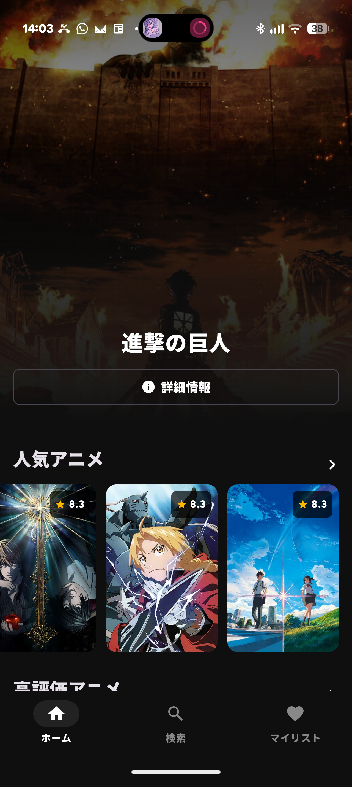
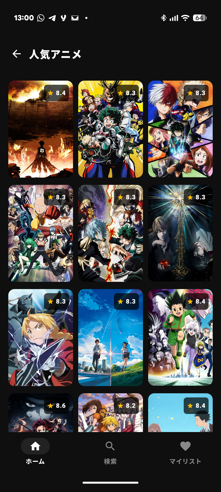
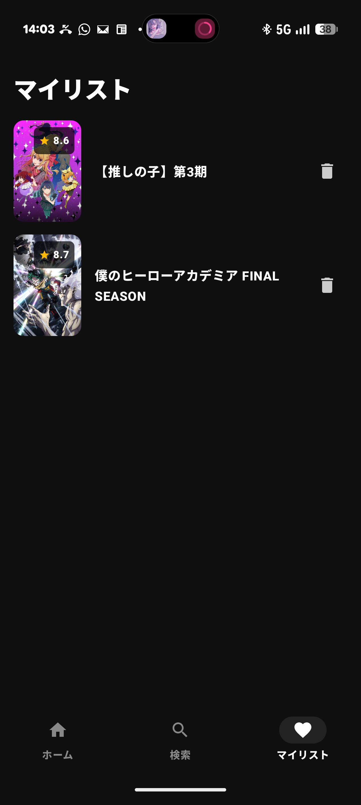
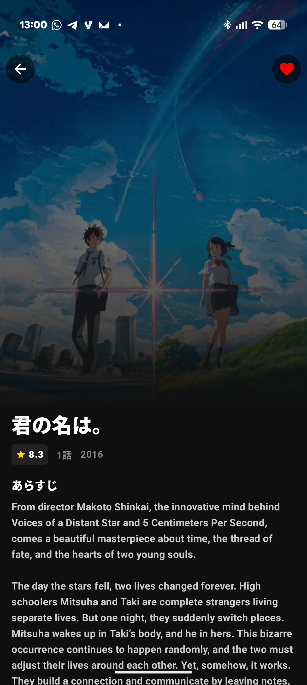
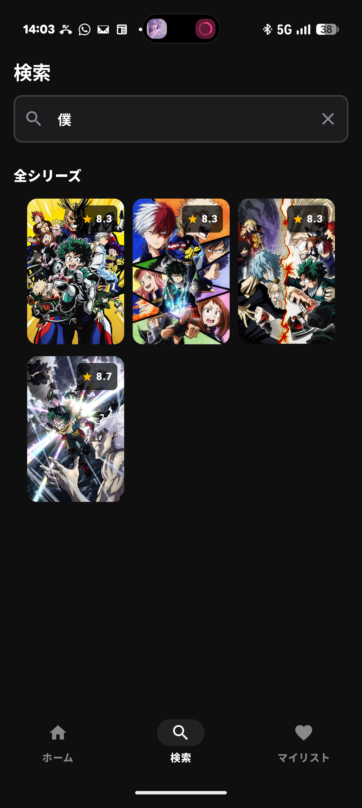
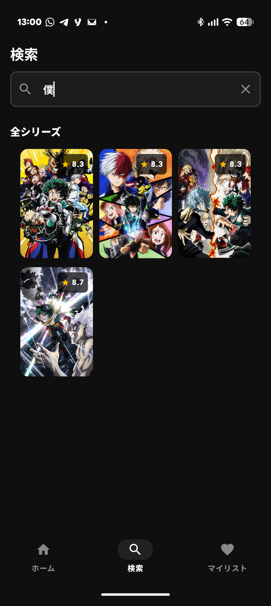
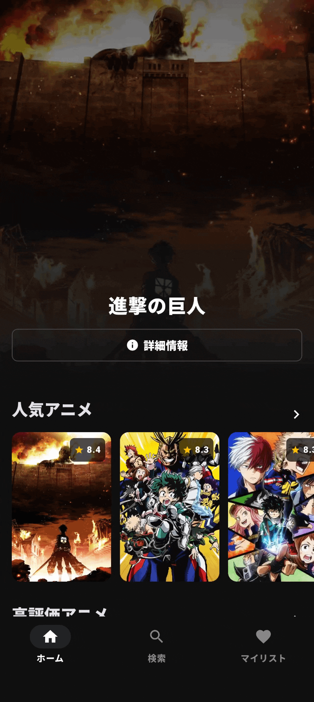
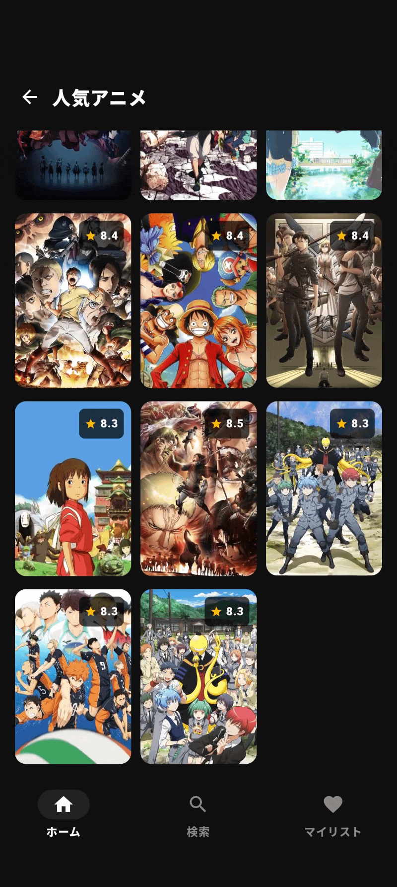
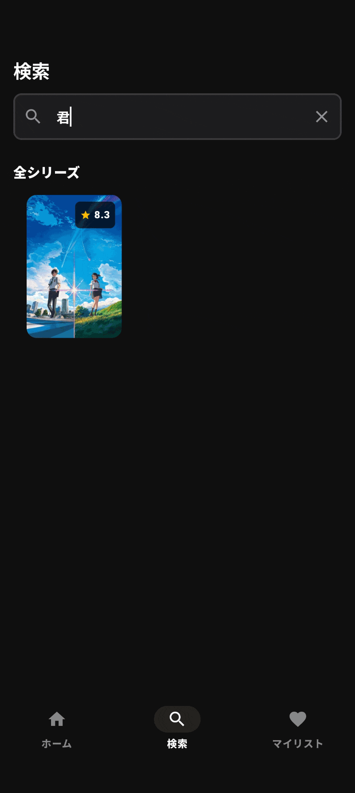
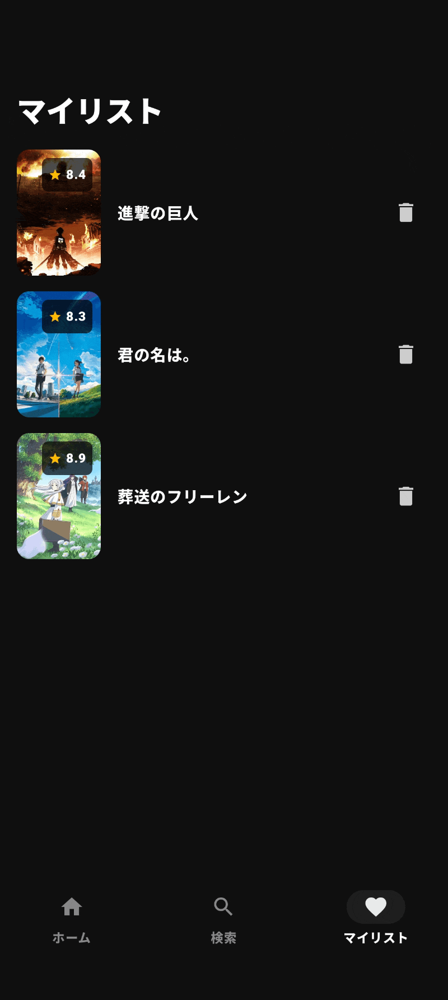

# AnimeList (アニメリストアプリ)

> Jetpack ComposeとモダンAndroidアーキテクチャ（MVVM / UDF）を採用した、アニメ作品の閲覧・検索・お気に入り管理を行うAndroidアプリケーションです。

---

## 📱 Screenshots (スクリーンショット)

| Home | Detail | My List |
| :---: | :---: | :---: |
|  |  |  |

| Details Added | Search | Search Result |
| :---: | :---: | :---: |
|  |  |  |

---

## 🎬 Feature Demos (機能デモ)

| Home & Transitions | Category Browsing | Instant Search | Favorites (Room DB) |
| :---: | :---: | :---: | :---: |
|  |  |  |  |
| **ホーム・バナー遷移** | **カテゴリー一覧** | **インクリメンタル検索** | **マイリスト・DB永続化** |

---

## 🌟 Key Features (主な機能)

* **ホーム画面 (Home):**
  * 注目の作品（Hero Banner）およびカテゴリー別セクション一覧のカルーセル表示
  * セクション詳細画面へのスムーズなスライド遷移（`AnimatedVisibility`）
  * ボトムナビゲーション再タップ時のトップ自動スクロール（`animateScrollToItem`）
* **インタラクティブな詳細画面 (Shared Element / Zoom Effect):**
  * ポスターカードの位置に合わせた滑らかな拡大・縮小トランジション（`AnimatedContent`）
  * 作品情報（あらすじ、エピソード数、ジャンルタグ、評価スター）の確認
* **リアルタイム検索 (Search):**
  * 検索キーワードに応じたインクリメンタルフィルタリング
  * 画面遷移や画面回転時にも検索状態を保持する状態管理（`SearchViewModel`）
* **マイリスト管理 (Favorites):**
  * ワンタップでお気に入り追加・削除（ローカルストレージ / Room連携）
  * リストが空の場合のプレースホルダー表示
* **UX最適化:**
  * 誤終了防止のための「戻る」ボタン2度押し検知とトースト通知
---

---

## 🏗️ Tech Stack & Architecture (技術スタック・設計)

### Architecture
* **MVVM (Model-View-ViewModel)**
* **UDF (Unidirectional Data Flow)** による予測可能でクリーンな状態管理
* **Stateful / Stateless の分離:** UIコンポーネントをViewModelから疎結合にし、プレビュー・テスト容易性を確保
* **Repository Pattern:** データソース（Kitsu API / Room DB）の抽象化とカプセル化

### Libraries & Tools
* **Language:** Kotlin 100%
* **UI:** Jetpack Compose, Material 3
* **Asynchronous:** Kotlin Coroutines & StateFlow
* **Lifecycle:** `collectAsStateWithLifecycle`
* **Local Storage:** Room Database / SQLite
* **Image Loading:** Coil (`AsyncImage`)
* **Animation:** Compose Animation (`AnimatedContent`, `AnimatedVisibility`)
* **Networking:** Retrofit2, OkHttp3

---

## 📁 Project Structure (パッケージ構成)

```text
com.example.animelist/
├── data/
│   ├── local/      # Room Database, DAO, Entity (マイリスト永続化)
│   └── network/    # Kitsu API 通信層 (Retrofit, DTO)
├── view_model/     # 各画面の状態管理 (HomePageViewModel, SearchViewModel, FavoriteViewModel)
└── ui/
    ├── components/ # 共通UIコンポーネント (AnimeCard, HeroBanner, AppBottomBar など)
    ├── model/      # UI用データモデル (AnimeItem, AnimeSection)
    ├── navigation/ # 画面遷移・ルート定義 (BottomNavItem)
    ├── screens/    # 各画面 (MainScreen, DetailScreen, main_screens/*)
    └── theme/      # カラーパレット、タイポグラフィ、MaterialTheme
```

---

## 🛠️ Getting Started (ビルド・実行手順)

本プロジェクトをローカル環境でビルドおよび実行するための手順です。

### 動作要件 (Prerequisites)
* **Android Studio:** Quail (2026.1.4) 以降推奨
* **JDK:** 17 以上 (推奨: 21 / 25)
* **Android SDK:**
  * `compileSdk`: 35
  * `minSdk`: 26 (Android 8.0 Oreo 以上)
  * `targetSdk`: 35

### セットアップ手順 (Setup & Run)

1. **リポジトリのクローン:**
   ```bash
   git clone [https://github.com/nihongonomeeru-hub/AnimeList.git](https://github.com/nihongonomeeru-hub/AnimeList.git)
   cd AnimeList
   ```

プロジェクトのインポート:

Android Studio を起動し、Open からクローンした AnimeList ディレクトリを選択します。

Gradle の同期（Sync Project with Gradle Files）が完了するまで待機します。

ビルドおよび実行:

実行先として実機（USBデバッグ有効化済み）または Android Emulator（API 26以上）を選択します。

Run 'app'（またはショートカット Ctrl + R / Shift + F10）を実行してアプリを起動します。

💡 補足事項 (APIについて):

アニメデータ取得には公開の Kitsu API を使用しているため、個別の API キー設定は不要です。プロジェクトをクローン後、そのままビルドして即座に動作確認が可能です。