# AnimeList (仮) - Modern Anime Tracker App

AniList GraphQL API を活用し、最新のアニメトレンド情報の閲覧からマイリスト管理までをスムーズに行える、Jetpack Compose 製のモダンな Android アプリケーションです。

---

## 📱 アプリ概要 (Overview)

- **ホーム (Home)**: おすすめ作品のカルーセル表示、人気アニメや年間ランキングなどの一覧表示
- **詳細画面 (Details)**: 作品のあらすじ、エピソード数、公式 PV（YouTube 連携）、キャスト（声優・登場人物）情報の詳細表示
- **検索 & フィルター (Search & Filter)**: 作品名・キーワード検索およびジャンル（アクション、ファンタジー等）による絞り込み機能
- **マイリスト (My List)**: お気に入り作品のローカル保存、Compose の `SwipeToDismiss` を用いた直感的なスワイプ削除機能

---

## 🛠 技術スタック (Tech Stack)

| カテゴリ               | 使用技術                                                     |
|:-------------------|:---------------------------------------------------------|
| **Language**       | Kotlin 100%                                              |
| **UI**             | Jetpack Compose, Material Design 3                       |
| **Architecture**   | MVVM, Clean Architecture, Unidirectional Data Flow (UDF) |
| **Asynchronous**   | Coroutines, StateFlow / SharedFlow                       |
| **Network / API**  | AniList GraphQL API (Apollo Kotlin )                     |
| **Local Database** | Room Database (オフラインキャッシュ & マイリスト保存)                     |
| **Image Loading**  | Coil                                                     |

---

## 💡 こだわり・実装のポイント (Key Technical Highlights)

### 1. 宣言的 UI によるリッチなユーザー体験
- Material 3 に準拠したダークテーマを基調とし、メディアリッチなデザインを実装。
- 詳細画面では、作品ビジュアル、公式 PV、キャスト一覧の水平スクロールなど、直感的で視覚的な導線を構築。
- マイリスト画面において、Compose の `SwipeToDismissBox` を採用し、スムーズなアニメーションを伴うスワイプ削除を実装。

### 2. 単方向データフロー (UDF) と状態管理
- UI（Composable）と ViewModel を疎結合に保ち、状態（State）は `StateFlow` を通じて単一方向に伝播。
- イベント（クリック、検索クエリの変更、リスト削除など）は ViewModel へ一元的に送信され、予測可能でテストしやすい状態管理を実現。

### 3. 最適なデータ取得とローカル永続化
- GraphQL を活用し、必要なフィールドのみを効率的に取得することでネットワーク通信量を削減。
- Room Database を用いてお気に入りリストをローカルにキャッシュし、オフライン環境下でも保存済みリストを快適に閲覧可能。

---

## 🎬 Feature Demos (機能デモ)

| Home & Transitions | Category Browsing | Instant Search | Favorites (Room DB) |
| :---: | :---: | :---: | :---: |
| 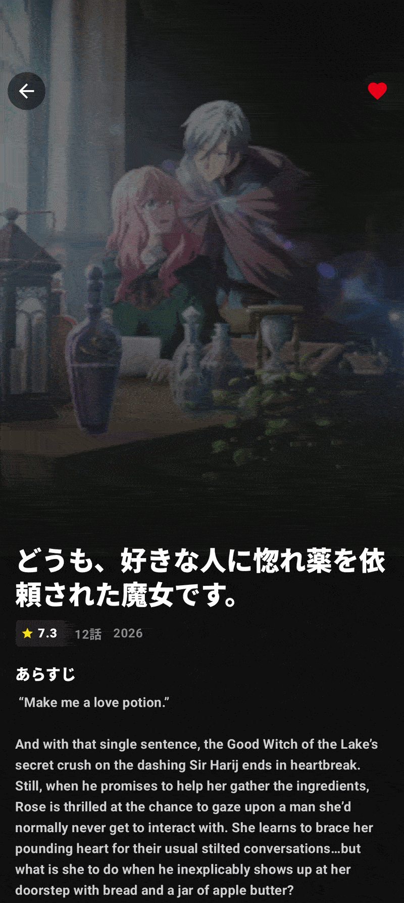 | 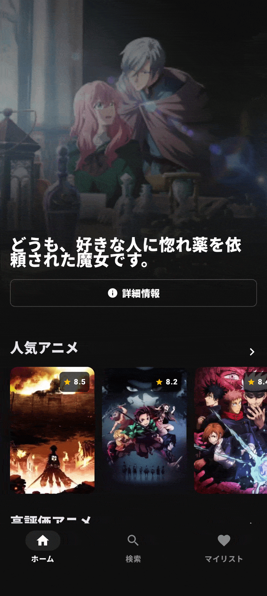 | 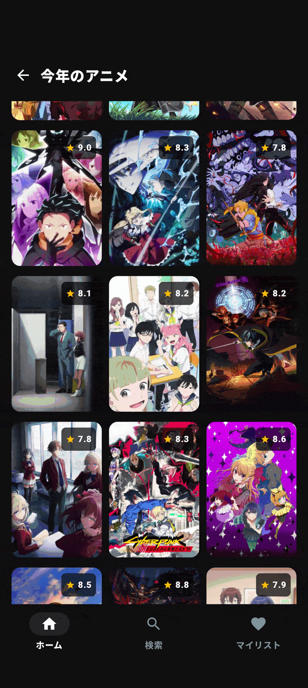 | 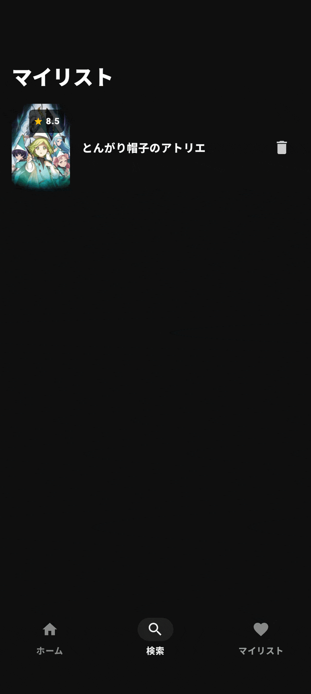 |
| **ホーム・バナー遷移** | **カテゴリー一覧** | **インクリメンタル検索** | **マイリスト・DB永続化** |

---

## 📸 スクリーンショット (Screenshots)

|                    ホーム画面                    |                   ランキング一覧                    |                    作品詳細画面                     |                    作品詳細画面(1)                    |
|:-------------------------------------------:|:--------------------------------------------:|:---------------------------------------------:|:-----------------------------------------------:|
| 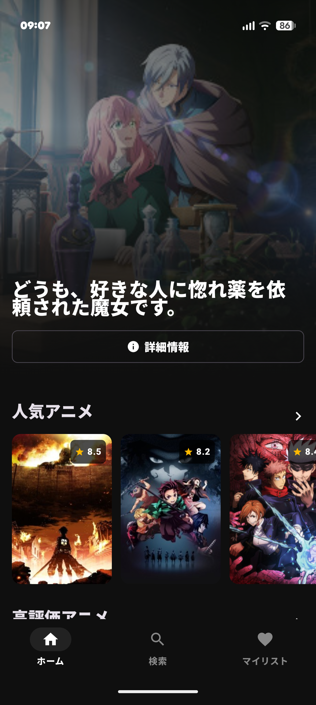 | 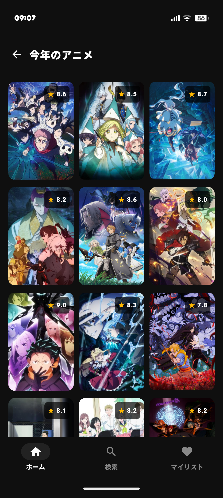 | 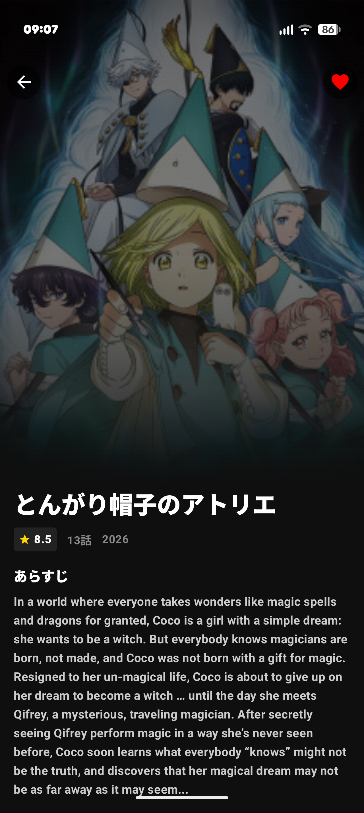 | 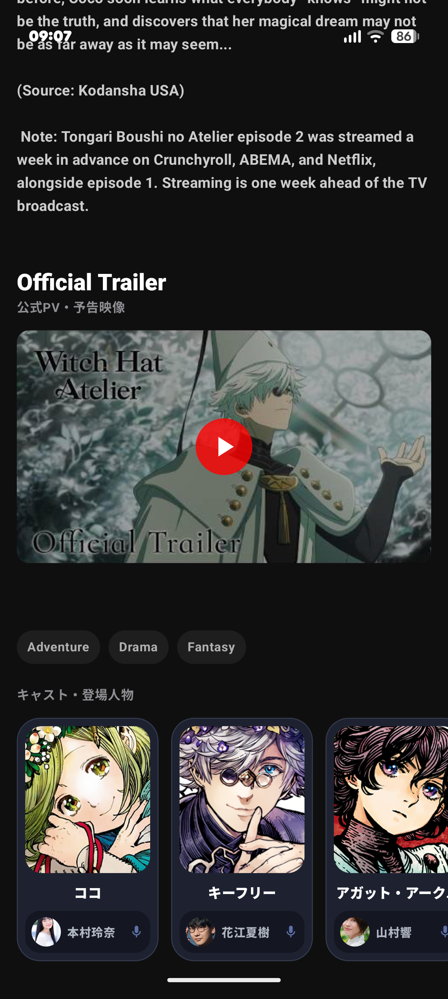 |

|                  検索・ジャンル絞り込み                  |                      マイリスト                       |                         スワイプ削除                          |
|:---------------------------------------------:|:------------------------------------------------:|:-------------------------------------------------------:|
| 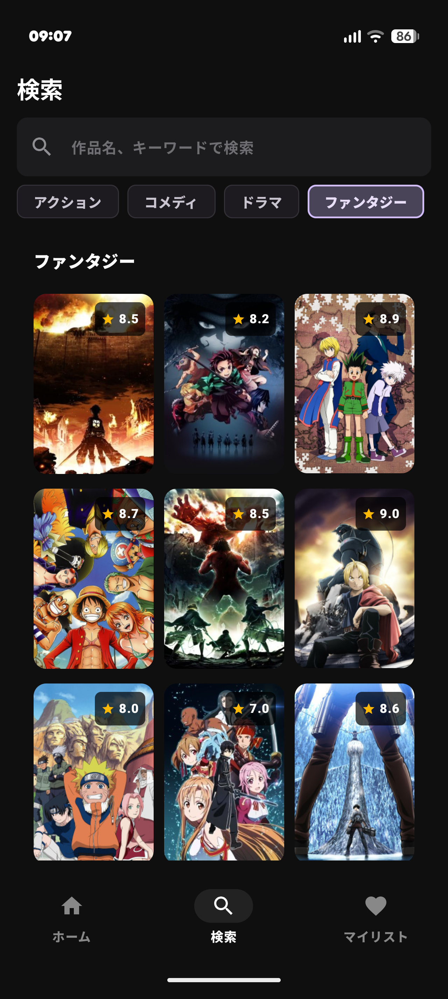 | 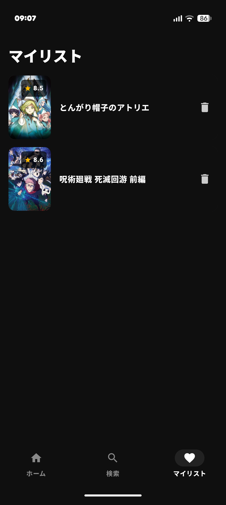 | 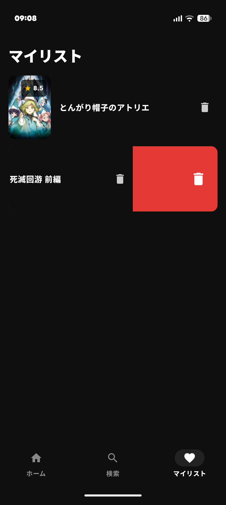 | 

---

## 🚀 開発環境 (Environment)

* **Android Studio:** Quail (2026.1.4) 以降推奨
* **JDK:** 17 以上 (推奨: 21 / 25)
* **Android SDK:**
  * `compileSdk`: 37
  * `minSdk`: 26 (Android 8.0 Oreo 以上)
  * `targetSdk`: 37

---